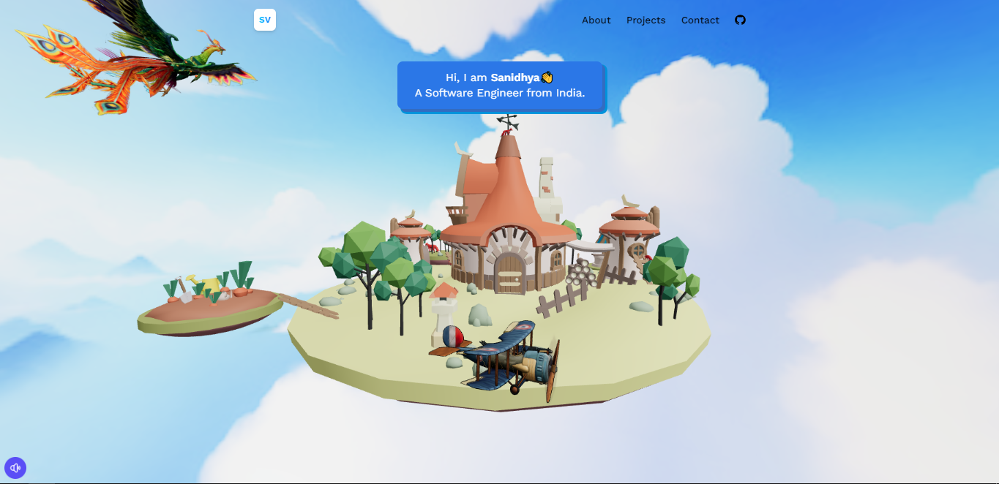

# Aditya Sharma - 3D Interactive Portfolio

An immersive, interactive 3D portfolio website built with **React 19**, **Three.js**, **React Three Fiber (@react-three/fiber)**, **React Three Drei (@react-three/drei)**, and **Tailwind CSS v4**.



## 👨‍💻 About Me

**Aditya Sharma**  
*Aspiring Full-Stack Web Developer | Computer Science Engineering Student*  
*Amity University (2024–2027)*  
📍 Ghaziabad, Uttar Pradesh, India  
✉️ [adityaa.sharma.mail@gmail.com](mailto:adityaa.sharma.mail@gmail.com)  
🌐 [LinkedIn](https://www.linkedin.com/in/aditya-sharma-624177355/) | [GitHub](https://github.com/aadi-iii) | [Instagram](https://www.instagram.com/whyy.aadiii?igsh=MWlwMTJtaGV1N215aw%3D%3D) | [Resume](https://aadi-iii.github.io/Aditya-Sharma-Resume/)

---

## 🚀 Key Projects

1. **One Drop** — Full-stack blood donation matching network with Firebase Authentication, Cloud Firestore, QR code system, and client-side PDF generation. ([Live Demo](https://1drop4u.online/))
2. **Interactive Product Inventory & Analytics Dashboard** — JavaScript internship project at EWB Edutech with dynamic categorization, filtering, and financial statistics. ([Live Demo](https://aadi-iii.github.io/Interactive-Product-Inventory-Analytics-Dashboard/))
3. **City Care Hospital** — Modern responsive healthcare portal frontend. ([Live Demo](https://aadi-iii.github.io/city-care-hospital-new/))
4. **Adiverse** — College-focused knowledge universe & productivity platform concept. ([GitHub](https://github.com/aadi-iii))
5. **Love Calculator** — Dynamic algorithmic compatibility application. ([Live Demo](https://aadi-iii.github.io/Love-Calculator/))
6. **Toxic Match** — Interactive social frontend project in vanilla JavaScript. ([Live Demo](https://aadi-iii.github.io/toxic-match/))
7. **Spider Robot** — Team-built multi-legged robotics prototype powered by an Arduino Nano and servo motors.

---

## 🛠️ Tech Stack

- **Frontend & 3D:** React 19, Three.js, @react-three/fiber, @react-three/drei, Tailwind CSS v4, React Router Dom
- **Languages:** JavaScript, TypeScript, Python, Java, C, HTML5, CSS3
- **Backend & Cloud:** FastAPI, Node.js, Firebase Auth, Cloud Firestore
- **Tooling:** Vite, Git, GitHub Pages, VS Code

---

## 💻 Getting Started Locally

### 1. Prerequisites
Make sure you have **Node.js** (v18+) installed.

### 2. Install Dependencies
```bash
npm install
```

### 3. Run Development Server
```bash
npm run dev
```
Open your browser and navigate to `http://localhost:5173`.

### 4. Build for Production
```bash
npm run build
```
The output files will be in the `dist` directory ready for deployment on Vercel, Netlify, or GitHub Pages.

---

## 📄 License
This project is licensed under the MIT License.
